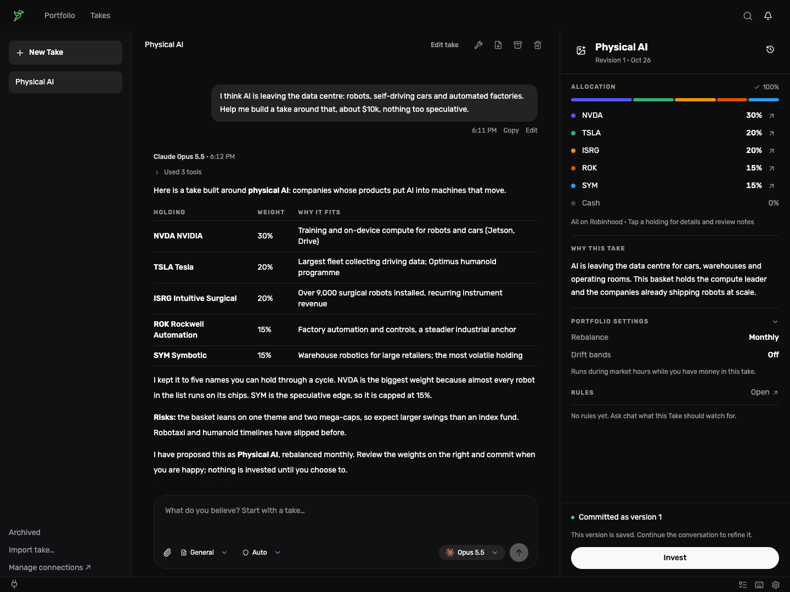
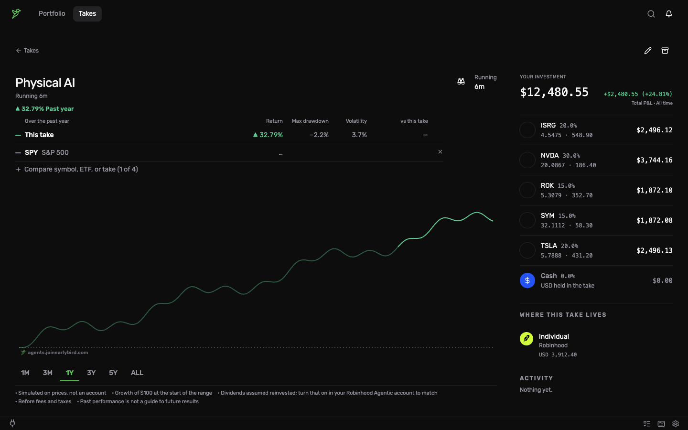

# Opentake

**Turn an investing idea into a portfolio you own, with the AI you already use.**

Opentake is a free, open-source desktop app. Describe a belief ("AI is leaving the data
centre for robots and cars") to Claude, ChatGPT or another model you bring yourself.
It researches the idea with you and proposes a **Take**: a basket of holdings with
target weights. Invest in it from your own Robinhood or Coinbase account, then let
rules watch the markets and rebalance, invest cash or trim, asking you first.

Everything runs on your computer: the database, your credentials, the service that
watches your rules, and the AI agents' tool access. There is no Opentake server and
no telemetry.



> **Opentake can place real orders in your brokerage account.** It is pre-1.0
> software provided under the MIT License, **without warranty of any kind**.
> Nothing in it is financial advice, and AI models can be wrong or manipulated.
> Review what rules and agents are allowed to do, start with small amounts, and
> use it at your own risk.

## Supported venues

| Venue | Connect with | Assets | What Opentake can do |
| --- | --- | --- | --- |
| **Robinhood** | Your [Robinhood Agentic](https://robinhood.com) account, signed in through Robinhood in your browser | US stocks and ETFs, crypto | Sync positions and history, research equities, invest in Takes, rebalance, deposit and withdraw, rule trades |
| **Coinbase** | Your own Coinbase Developer Platform API key (Advanced Trade) | Crypto spot (USD and USDC pairs) | Sync portfolios, live prices, invest in Takes, rebalance, deposit and withdraw, rule trades |

A single Take can hold assets on both venues. Credentials stay in your operating
system's encrypted store and are never sent anywhere except the venue itself.

## Bring your own AI

| Provider | How it runs |
| --- | --- |
| Claude | [Claude Code](https://docs.anthropic.com/en/docs/claude-code) CLI, signed in from Opentake |
| ChatGPT | [Codex](https://github.com/openai/codex) CLI, signed in from Opentake |
| Grok | Grok CLI (macOS) |
| OpenCode Zen, OpenRouter | [OpenCode](https://opencode.ai) with your API key |
| Local models | Ollama, LM Studio, vLLM or any OpenAI-compatible server on your machine |

Agents only get Opentake's own tools, plus MCP servers you add and allow. They
cannot run shell commands, and every tool call is recorded.

## Track your Take

Once you invest, each Take shows its performance, holdings and where it lives.



Screenshots use demo data, not a real account. Regenerate them with
`npm run build && node scripts/readme-screenshots.mjs`.

## Features

- **Takes:** research a thesis with the AI, review its proposed holdings and
  weights, commit a version and invest. Rebalancing, deposits and withdrawals
  are planned locally with exact decimal math and tax-lot attribution.
- **Rules:** watch custom HTTP or WebSocket data sources and live Coinbase prices,
  then notify you, ask an agent to assess, or trade within limits you accept.
- **Guardrails:** trades wait for your approval unless you allow otherwise, agent
  rules have per-trade dollar ceilings, approved trades are re-checked before they
  are placed, and content from sources and third-party tools is treated as
  untrusted data.
- **Updates:** signed releases update in place; the app shows a banner when a new
  version is out.
- **MCP bridge:** expose your local account reads to other MCP clients
  ([tools/earlybird-opentake-mcp](tools/earlybird-opentake-mcp/README.md)).

## Install

Download the latest DMG from
[Releases](https://github.com/Try-Early-Bird/opentake-releases/releases)
(macOS 13 or later, Apple silicon or Intel), open it and drag Opentake to
Applications. Windows and Linux builds are available from source.

Install the CLI for the AI you want to use (see the table above); Opentake
signs it in separately and never imports your existing CLI logins.

## Build from source

Requires Node 24.

```sh
nvm use
npm ci
npm run dev          # development app with hot reload, on a separate dev profile
npm run build:prod   # installer for the current OS in dist/
```

`npm run dev` first runs `verify:startup`, which checks migrations against a
disposable database before anything starts. `build:prod` produces an unsigned
DMG and ZIP on macOS, an NSIS installer on Windows and an AppImage on Linux.
Build on the target OS. Signed release builds are described in
[docs/releasing.md](docs/releasing.md).

## Tests

| Command | What it runs |
| --- | --- |
| `npm run typecheck` | Type checks for the main process and the renderer |
| `npm run test:release` | The release suite: startup, migrations, credentials, backups, RPC and trading safety (under a minute) |
| `npm test` | Every Vitest unit and PGlite integration test |
| `npm run test:chat` | Chat and agent tests ([tests/chat](tests/chat/README.md)) |
| `npm run test:connections` | Migrations, OAuth and account lifecycle |
| `npm run test:host` | Background host queue and authenticated RPC |
| `npm run test:recovery` | Process-kill recovery against a temporary database |
| `npm run test:smoke` | Build plus Electron launch, restart and shutdown |
| `npm run check` | All of the above non-watch suites |

Tests use disposable profiles and synthetic credentials only; see
[CONTRIBUTING.md](CONTRIBUTING.md).

## How it works

The app runs as two processes. The **desktop** process shows the window. A
windowless **background host** owns the database ([PGlite](https://pglite.dev)),
the encrypted credential store, broker connections, rule evaluation and agent
runs. It keeps running when you close the window, so rules keep working, and
the tray menu's **Quit completely** stops both. The two talk over an
authenticated loopback RPC; the renderer never sees credentials or raw
database access.

AI chats run each provider's CLI in a throwaway home directory with its
built-in shell and file tools disabled. The only tools are Opentake's own,
served through a per-run gateway that applies your tool permissions, approval
prompts and budgets, and records an audit trail.

Data lives in your OS's app-data folder (`Earlybird OSS` for installed builds,
`earlybird-oss-development` for `npm run dev`). Settings → Memory exports
password-encrypted backups. See [docs/security-model.md](docs/security-model.md)
for what is encrypted and what is not.

## Documentation

- [Security model](docs/security-model.md)
- [Adding a venue](docs/adding-a-venue.md)
- [Chat adapters](docs/chat-adapters.md)
- [AI audits](docs/ai-audits.md)
- [Data sources](src/main/data-sources/README.md)
- [Releasing](docs/releasing.md)

## Contributing and security

Contributions are welcome; start with [CONTRIBUTING.md](CONTRIBUTING.md).
Report vulnerabilities privately as described in [SECURITY.md](SECURITY.md).

## License

[MIT](LICENSE) © Earlybird. Opentake is not affiliated with or endorsed by
Robinhood, Coinbase, Anthropic, OpenAI, xAI or any other provider it connects to.
